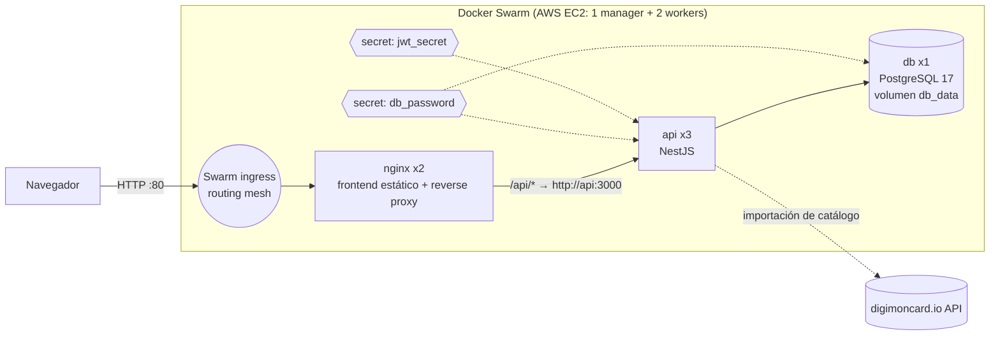
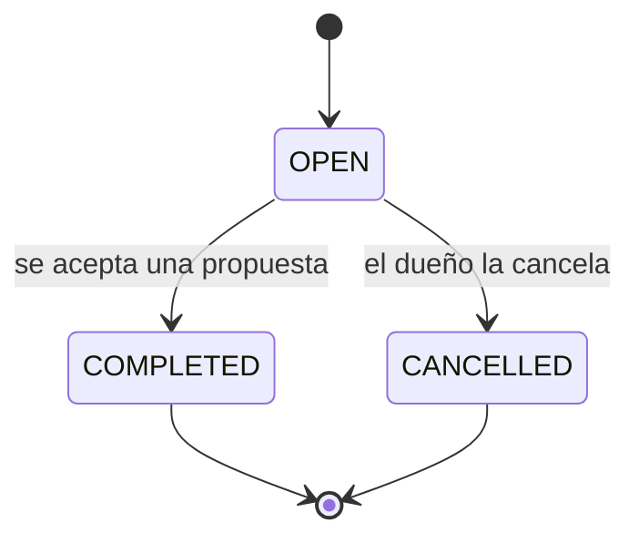
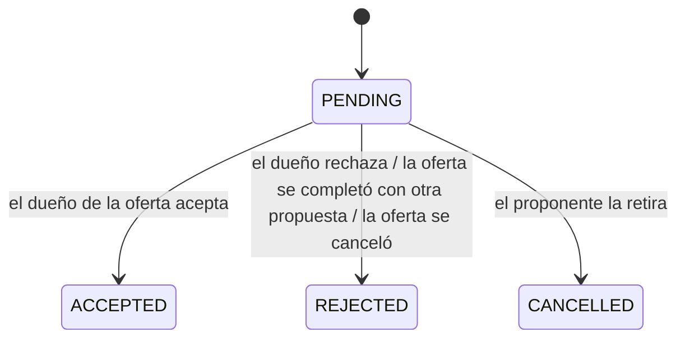

# FoilHub — Arquitectura

Plataforma web para intercambiar (tradear) cartas del Digimon Card Game. Un usuario registrado publica una **oferta**: "doy N copias de la carta X y quiero M copias de la carta Y". Otros usuarios pueden **proponer** un intercambio sobre esa oferta; el dueño la acepta o la rechaza. El intercambio físico ocurre fuera de la plataforma: al aceptar, cada parte ve el contacto de la otra.

Este documento es la fuente de verdad del diseño. Si el código y este documento no coinciden, se corrige uno de los dos en el mismo PR.

---

## 1. Vista de despliegue



| Servicio | Imagen | Réplicas | Redes | Publica puertos |
|---|---|---|---|---|
| `nginx` | `foilhub-nginx` (build de React + nginx.conf) | 2 | `edge` | 80 |
| `api` | `foilhub-api` (NestJS) | 3 | `edge`, `backend` | no |
| `db` | `postgres:17-alpine` | 1 (fijado con `node.labels.db == true`) | `backend` | no |
| `visualizer` (opcional, para la demo) | `dockersamples/visualizer` | 1 (en manager) | — | 8080 |

- `edge`: overlay entre nginx y api.
- `backend`: overlay `internal: true` entre api y db. La base de datos no tiene salida a internet ni puertos publicados.
- La API no guarda estado en memoria (JWT, nada de sesiones) → se puede escalar a N réplicas.

---

## 2. Capas (Clean Architecture)

Regla de dependencia: **las importaciones solo apuntan hacia adentro**.

```
infrastructure  →  interface-adapters  →  application  →  domain
   (capa 4)             (capa 3)            (capa 2)       (capa 1)
```

| Carpeta (`backend/src/`) | Capa | Contiene | Puede importar |
|---|---|---|---|
| `domain/` | 1 — Entidades | Entidades, value objects, servicios de dominio (`TradeMatcher`), errores de dominio | Nada fuera de `domain/` |
| `application/` | 2 — Casos de uso | Casos de uso, puertos (interfaces), tipos de entrada/salida | `domain/` |
| `interface-adapters/` | 3 — Adaptadores | Controllers HTTP, DTOs HTTP, presenters, mappers, repositorios Prisma, guards, filtros de excepciones, tokens de DI | `application/`, `domain/`, `src/generated/prisma` (tipos), `@nestjs/*` |
| `infrastructure/` | 4 — Frameworks | `main.ts`, módulos Nest (cableado), `PrismaService`, bcrypt, JWT, cliente HTTP de digimoncard.io, lectura de secrets, health, CLI | Todo |

Prohibido:
- `domain/` y `application/` **no** importan `@nestjs/*`, `@prisma/*`, `src/generated/**`, `class-validator`, `bcryptjs`, `jsonwebtoken`, ni nada de capas externas.
- `interface-adapters/` **no** importa nada de `infrastructure/`.
- Se refuerza con `no-restricted-imports` en ESLint (ver tarea A1 del plan). `npm run lint` debe fallar si alguien rompe la regla.

### Cómo se conecta Nest sin ensuciar el dominio

- Los **casos de uso** son clases TypeScript puras, sin `@Injectable()`. Reciben sus puertos por constructor.
- Los **repositorios Prisma** (capa 3) también son clases puras que reciben un `PrismaClient` por constructor.
- Los **módulos Nest** (capa 4) arman todo con `useFactory`:

```ts
// infrastructure/modules/offers.module.ts
@Module({
  controllers: [OffersController],
  providers: [
    { provide: TRADE_OFFER_REPOSITORY, useFactory: (p: PrismaService) => new PrismaTradeOfferRepository(p), inject: [PrismaService] },
    {
      provide: CreateTradeOfferUseCase,
      useFactory: (offers, cards, ids, clock) => new CreateTradeOfferUseCase(offers, cards, ids, clock),
      inject: [TRADE_OFFER_REPOSITORY, CARD_REPOSITORY, ID_GENERATOR, CLOCK],
    },
  ],
})
export class OffersModule {}
```

- Los controllers inyectan el caso de uso por su clase: `constructor(private readonly createOffer: CreateTradeOfferUseCase) {}`.
- Los tokens de DI (`Symbol(...)`) viven en `interface-adapters/di-tokens.ts`, porque los usan los guards (capa 3) y los módulos (capa 4).

---

## 3. Modelo de dominio

### Value objects

| VO | Regla |
|---|---|
| `Username` | 3–20 caracteres, `[a-zA-Z0-9_]`. Se guarda en minúsculas (único sin distinguir mayúsculas). |
| `CardCode` | Código impreso de la carta, ej. `BT1-084`, `ST1-01`, `EX2-039`, `P-001`. Se normaliza a mayúsculas y sin espacios. Regex: `^[A-Z0-9]{1,6}-\d{2,3}$`. |
| `Quantity` | Entero entre 1 y 99. |
| `PlainPassword` | Mínimo 8 caracteres, máximo 72 (límite de bcrypt). Solo existe en memoria; nunca se persiste. |

### Entidades

Todas tienen constructor privado, `static create(...)` (valida invariantes, para objetos nuevos) y `static restore(...)` (reconstruye desde persistencia sin revalidar).

**User**
- `id`, `username: Username`, `passwordHash: string`, `contactInfo: string | null` (Discord/WhatsApp/email, máx. 100 caracteres), `createdAt`.

**Card** (catálogo, solo lectura para los usuarios)
- `id`, `code: CardCode` (único), `name`, `setName | null`, `rarity | null`, `color | null`, `cardType | null`, `imageUrl | null`.

**TradeOffer**
- `id`, `ownerId`, `offeredCardId`, `offeredQuantity: Quantity`, `wantedCardId`, `wantedQuantity: Quantity`, `status`, `createdAt`, `closedAt | null`.
- Invariante: `offeredCardId !== wantedCardId` → `SameCardTradeError`.
- Máquina de estados:



- Métodos: `cancel(byUserId)` (solo el dueño, solo si `OPEN`), `complete(at)` (solo si `OPEN`).

**TradeProposal**
- `id`, `offerId`, `proposerId`, `counterOfferId | null`, `message | null` (máx. 280), `status`, `createdAt`, `respondedAt | null`.
- `counterOfferId` es opcional: el proponente puede vincular una oferta suya que sea exactamente la inversa (un *match*). Si la vincula, al aceptar se completan ambas ofertas.
- Máquina de estados:



- Métodos: `accept(byUserId, offer)`, `reject(byUserId, offer)`, `cancel(byUserId)`, `autoReject(at)`.

### Servicio de dominio: `TradeMatcher`

`isMatch(a: TradeOffer, b: TradeOffer): boolean` es verdadero si **todas** se cumplen:
1. `a.ownerId !== b.ownerId`
2. ambas están `OPEN`
3. `a.offeredCardId === b.wantedCardId` y `a.wantedCardId === b.offeredCardId`
4. `a.offeredQuantity === b.wantedQuantity` y `a.wantedQuantity === b.offeredQuantity`

(Coincidencia exacta de cantidades en el MVP. Coincidencias parciales quedan como mejora futura.)

El repositorio solo **acota candidatos** (ofertas abiertas con las cartas invertidas); la decisión final siempre la toma `TradeMatcher` en el dominio.

### Errores de dominio

Todos extienden `DomainError` con un `code` estable (string).

| Error | `code` | HTTP |
|---|---|---|
| `InvalidUsernameError` | `INVALID_USERNAME` | 400 |
| `InvalidCardCodeError` | `INVALID_CARD_CODE` | 400 |
| `InvalidQuantityError` | `INVALID_QUANTITY` | 400 |
| `WeakPasswordError` | `WEAK_PASSWORD` | 400 |
| `SameCardTradeError` | `SAME_CARD_TRADE` | 400 |
| `InvalidCredentialsError` | `INVALID_CREDENTIALS` | 401 |
| `NotOfferOwnerError` | `FORBIDDEN` | 403 |
| `NotProposalPartyError` | `FORBIDDEN` | 403 |
| `UserNotFoundError` | `USER_NOT_FOUND` | 404 |
| `CardNotFoundError` | `CARD_NOT_FOUND` | 404 |
| `OfferNotFoundError` | `OFFER_NOT_FOUND` | 404 |
| `ProposalNotFoundError` | `PROPOSAL_NOT_FOUND` | 404 |
| `UsernameTakenError` | `USERNAME_TAKEN` | 409 |
| `OfferNotOpenError` | `OFFER_NOT_OPEN` | 409 |
| `ProposalNotPendingError` | `PROPOSAL_NOT_PENDING` | 409 |
| `DuplicateProposalError` | `DUPLICATE_PROPOSAL` | 409 |
| `ConcurrencyConflictError` | `CONCURRENCY_CONFLICT` | 409 |
| `CannotTradeWithYourselfError` | `SELF_TRADE` | 422 |
| `CounterOfferNotMatchingError` | `COUNTER_OFFER_NOT_MATCHING` | 422 |

Errores que no son de dominio: `VALIDATION_ERROR` (400, DTO inválido), `UNAUTHORIZED` (401, falta el token o no es válido), `TOO_MANY_REQUESTS` (429, throttler), `INTERNAL_ERROR` (500; el mensaje nunca expone detalles internos).

El mapeo a HTTP lo hace `DomainExceptionFilter` (capa 3). El dominio no sabe de HTTP.

---

## 4. Casos de uso (capa 2)

Cada caso de uso es una clase con un único método `execute(input): Promise<output>`. Entradas y salidas son tipos planos (no entidades, no DTOs HTTP).

| Módulo | Caso de uso | Resumen | Errores |
|---|---|---|---|
| auth | `RegisterUserUseCase` | Valida username/password, verifica unicidad, hashea, guarda | `UsernameTaken`, validaciones |
| auth | `LoginUserUseCase` | Verifica credenciales, emite token | `InvalidCredentials` (mismo error si no existe el usuario o la clave es incorrecta) |
| auth | `GetCurrentUserUseCase` | Devuelve el usuario del token | `UserNotFound` |
| cards | `SearchCardsUseCase` | Búsqueda paginada por nombre o código | — |
| cards | `GetCardByCodeUseCase` | Detalle de una carta | `CardNotFound` |
| cards | `ImportCardCatalogUseCase` | Trae el catálogo del proveedor y hace upsert por `code`; devuelve `{ imported, skipped }` | — |
| offers | `CreateTradeOfferUseCase` | Resuelve cartas por código, crea oferta `OPEN` | `CardNotFound`, `SameCardTrade`, `InvalidQuantity` |
| offers | `ListOpenOffersUseCase` | Ofertas `OPEN` paginadas, filtro opcional por carta ofrecida/buscada; excluye las del propio usuario si está autenticado | — |
| offers | `ListMyOffersUseCase` | Ofertas del usuario, filtro por estado | — |
| offers | `GetOfferUseCase` | Detalle | `OfferNotFound` |
| offers | `CancelTradeOfferUseCase` | Cancela y auto-rechaza sus propuestas `PENDING` (en una transacción) | `OfferNotFound`, `NotOfferOwner`, `OfferNotOpen` |
| offers | `FindMatchesForOfferUseCase` | Candidatos del repo filtrados con `TradeMatcher` | `OfferNotFound`, `NotOfferOwner` |
| proposals | `ProposeTradeUseCase` | Crea propuesta `PENDING` sobre una oferta `OPEN` ajena; valida `counterOfferId` con `TradeMatcher` | `OfferNotFound`, `OfferNotOpen`, `SelfTrade`, `DuplicateProposal`, `CounterOfferNotMatching` |
| proposals | `ListMyProposalsUseCase` | `box = sent \| received`, filtro por estado | — |
| proposals | `AcceptProposalUseCase` | En **una transacción**: propuesta → `ACCEPTED`, oferta → `COMPLETED`, contraoferta (si hay) → `COMPLETED`, demás `PENDING` de esa oferta → `REJECTED`. Devuelve los contactos de ambas partes | `ProposalNotFound`, `NotOfferOwner`, `ProposalNotPending`, `OfferNotOpen`, `ConcurrencyConflict` |
| proposals | `RejectProposalUseCase` | Solo el dueño de la oferta | `ProposalNotFound`, `NotOfferOwner`, `ProposalNotPending` |
| proposals | `CancelProposalUseCase` | Solo el proponente | `ProposalNotFound`, `NotProposalParty`, `ProposalNotPending` |

### Puertos (`application/ports/`)

```ts
interface UserRepository {
  findById(id: string): Promise<User | null>;
  findByUsername(username: Username): Promise<User | null>;
  save(user: User): Promise<void>;            // insert o update
}

interface CardRepository {
  findById(id: string): Promise<Card | null>;
  findByCode(code: CardCode): Promise<Card | null>;
  findByIds(ids: string[]): Promise<Card[]>;
  search(q: { text?: string; page: number; pageSize: number }): Promise<Page<Card>>;
  upsertMany(cards: Card[]): Promise<number>;
}

interface TradeOfferRepository {
  findById(id: string): Promise<TradeOffer | null>;
  listOpen(q: { offeredCardId?: string; wantedCardId?: string; excludeOwnerId?: string; page: number; pageSize: number }): Promise<Page<TradeOffer>>;
  listByOwner(ownerId: string, status?: OfferStatus): Promise<TradeOffer[]>;
  findMatchCandidates(offer: TradeOffer): Promise<TradeOffer[]>;
  save(offer: TradeOffer): Promise<void>;     // al pasar de OPEN a otro estado: UPDATE ... WHERE status = 'OPEN'; si afecta 0 filas → ConcurrencyConflictError
}

interface TradeProposalRepository {
  findById(id: string): Promise<TradeProposal | null>;
  findPendingByOffer(offerId: string): Promise<TradeProposal[]>;
  existsPending(offerId: string, proposerId: string): Promise<boolean>;
  listForUser(q: { userId: string; box: 'sent' | 'received'; status?: ProposalStatus }): Promise<TradeProposal[]>;
  save(p: TradeProposal): Promise<void>;
  saveMany(ps: TradeProposal[]): Promise<void>;
}

interface UnitOfWork {
  run<T>(work: (repos: { offers: TradeOfferRepository; proposals: TradeProposalRepository }) => Promise<T>): Promise<T>;
}

interface PasswordHasher { hash(plain: string): Promise<string>; verify(plain: string, hash: string): Promise<boolean>; }
interface TokenService  { sign(payload: { sub: string; username: string }): Promise<string>; verify(token: string): Promise<{ sub: string; username: string }>; }
interface CardCatalogProvider { fetchAll(): Promise<CatalogCard[]>; }   // CatalogCard = tipo plano con code, name, setName, ...
interface IdGenerator { next(): string; }
interface Clock { now(): Date; }
```

`Page<T> = { items: T[]; page: number; pageSize: number; total: number }`.

Implementaciones:

| Puerto | Implementación | Capa |
|---|---|---|
| Repositorios + `UnitOfWork` | `Prisma*Repository`, `PrismaUnitOfWork` (usa `prisma.$transaction(async tx => …)` y crea repos con `tx`) | 3 |
| `PasswordHasher` | `BcryptPasswordHasher` (`bcryptjs`, costo 12) | 4 |
| `TokenService` | `JwtTokenService` (`@nestjs/jwt`, HS256, expira en `JWT_EXPIRES_IN`, por defecto 1h) | 4 |
| `CardCatalogProvider` | `DigimonCardIoCatalogProvider` (HTTP) y `JsonFileCatalogProvider` (`backend/prisma/seed/cards.sample.json`) | 4 |
| `IdGenerator` | `CryptoIdGenerator` (`crypto.randomUUID()`) | 4 |
| `Clock` | `SystemClock` | 4 |

Para tests de casos de uso: fakes en memoria en `backend/test/fakes/` (`InMemoryTradeOfferRepository`, `FakePasswordHasher`, `FixedClock`, `SequentialIdGenerator`, `InMemoryUnitOfWork`).

---

## 5. Base de datos (Prisma 7 + PostgreSQL 17)

Boceto del esquema (la sintaxis exacta del `generator`/`datasource` se toma de la documentación de Prisma 7; en Prisma 7 la URL de conexión va en `prisma.config.ts`):

```prisma
generator client {
  provider = "prisma-client"
  output   = "../src/generated/prisma"
}

datasource db {
  provider = "postgresql"
}

enum OfferStatus    { OPEN COMPLETED CANCELLED }
enum ProposalStatus { PENDING ACCEPTED REJECTED CANCELLED }

model User {
  id           String   @id @db.Uuid
  username     String   @unique            // siempre en minúsculas
  passwordHash String   @map("password_hash")
  contactInfo  String?  @map("contact_info") @db.VarChar(100)
  createdAt    DateTime @map("created_at")
  offers       TradeOffer[]
  proposals    TradeProposal[]
  @@map("users")
}

model Card {
  id        String  @id @db.Uuid
  code      String  @unique
  name      String
  setName   String? @map("set_name")
  rarity    String?
  color     String?
  cardType  String? @map("card_type")
  imageUrl  String? @map("image_url")
  offered   TradeOffer[] @relation("OfferedCard")
  wanted    TradeOffer[] @relation("WantedCard")
  @@index([name])
  @@map("cards")
}

model TradeOffer {
  id              String      @id @db.Uuid
  ownerId         String      @map("owner_id") @db.Uuid
  offeredCardId   String      @map("offered_card_id") @db.Uuid
  offeredQuantity Int         @map("offered_quantity")
  wantedCardId    String      @map("wanted_card_id") @db.Uuid
  wantedQuantity  Int         @map("wanted_quantity")
  status          OfferStatus @default(OPEN)
  createdAt       DateTime    @map("created_at")
  closedAt        DateTime?   @map("closed_at")
  owner           User        @relation(fields: [ownerId], references: [id])
  offeredCard     Card        @relation("OfferedCard", fields: [offeredCardId], references: [id])
  wantedCard      Card        @relation("WantedCard", fields: [wantedCardId], references: [id])
  proposals       TradeProposal[] @relation("ProposalOffer")
  counterFor      TradeProposal[] @relation("ProposalCounterOffer")
  @@index([status, offeredCardId, wantedCardId])
  @@map("trade_offers")
}

model TradeProposal {
  id             String         @id @db.Uuid
  offerId        String         @map("offer_id") @db.Uuid
  proposerId     String         @map("proposer_id") @db.Uuid
  counterOfferId String?        @map("counter_offer_id") @db.Uuid
  message        String?        @db.VarChar(280)
  status         ProposalStatus @default(PENDING)
  createdAt      DateTime       @map("created_at")
  respondedAt    DateTime?      @map("responded_at")
  offer          TradeOffer     @relation("ProposalOffer", fields: [offerId], references: [id])
  counterOffer   TradeOffer?    @relation("ProposalCounterOffer", fields: [counterOfferId], references: [id])
  proposer       User           @relation(fields: [proposerId], references: [id])
  @@index([offerId, status])
  @@map("trade_proposals")
}
```

Los IDs los genera el dominio (`IdGenerator`), por eso no hay `@default(uuid())`.

Restricción adicional (migración SQL manual): índice único parcial para que no existan dos propuestas `PENDING` del mismo usuario sobre la misma oferta:

```sql
CREATE UNIQUE INDEX trade_proposals_one_pending
  ON trade_proposals (offer_id, proposer_id) WHERE status = 'PENDING';
```

---

## 6. Contrato de la API REST

Prefijo global: `/api`. Autenticación: `Authorization: Bearer <token>`. 🔒 = requiere token.

### Formato de error (todas las respuestas 4xx/5xx)

```json
{ "statusCode": 409, "error": "OFFER_NOT_OPEN", "message": "La oferta ya no está abierta" }
```

Errores de validación de DTOs: `400`, `error: "VALIDATION_ERROR"`, `message` con la lista de campos.

### Tipos de respuesta

```ts
type CardDto = { code: string; name: string; setName: string | null; rarity: string | null; color: string | null; cardType: string | null; imageUrl: string | null };
type UserSummaryDto = { id: string; username: string };
type OfferDto = {
  id: string;
  owner: UserSummaryDto;
  offered: { card: CardDto; quantity: number };
  wanted:  { card: CardDto; quantity: number };
  status: 'OPEN' | 'COMPLETED' | 'CANCELLED';
  createdAt: string;            // ISO 8601
  closedAt: string | null;
};
type ProposalDto = {
  id: string;
  offer: OfferDto;
  proposer: UserSummaryDto;
  counterOffer: OfferDto | null;
  message: string | null;
  status: 'PENDING' | 'ACCEPTED' | 'REJECTED' | 'CANCELLED';
  createdAt: string;
  respondedAt: string | null;
  contacts: { offerOwner: string | null; proposer: string | null } | null; // solo si ACCEPTED y quien consulta es una de las partes
};
type PageDto<T> = { items: T[]; page: number; pageSize: number; total: number };
```

### Endpoints

| Método | Ruta | Body / Query | Respuesta |
|---|---|---|---|
| POST | `/api/auth/register` | `{ username, password, contactInfo? }` | `201 UserSummaryDto` |
| POST | `/api/auth/login` | `{ username, password }` | `200 { accessToken, tokenType: "Bearer", expiresIn, user: UserSummaryDto }` |
| GET 🔒 | `/api/auth/me` | — | `200 { id, username, contactInfo }` |
| GET | `/api/cards` | `?search=agumon&page=1&pageSize=20` (pageSize máx. 50) | `200 PageDto<CardDto>` |
| GET | `/api/cards/:code` | — | `200 CardDto` |
| GET | `/api/offers` | `?offeredCardCode=&wantedCardCode=&page=&pageSize=` | `200 PageDto<OfferDto>` (solo `OPEN`) |
| POST 🔒 | `/api/offers` | `{ offeredCardCode, offeredQuantity, wantedCardCode, wantedQuantity }` | `201 OfferDto` |
| GET 🔒 | `/api/offers/mine` | `?status=OPEN` | `200 OfferDto[]` |
| GET | `/api/offers/:id` | — | `200 OfferDto` |
| POST 🔒 | `/api/offers/:id/cancel` | — | `200 OfferDto` |
| GET 🔒 | `/api/offers/:id/matches` | — | `200 OfferDto[]` (solo el dueño) |
| POST 🔒 | `/api/offers/:id/proposals` | `{ counterOfferId?, message? }` | `201 ProposalDto` |
| GET 🔒 | `/api/proposals` | `?box=received\|sent&status=PENDING` | `200 ProposalDto[]` |
| POST 🔒 | `/api/proposals/:id/accept` | — | `200 ProposalDto` (incluye `contacts`) |
| POST 🔒 | `/api/proposals/:id/reject` | — | `200 ProposalDto` |
| POST 🔒 | `/api/proposals/:id/cancel` | — | `200 ProposalDto` |
| GET | `/api/health` | — | `200 { status: "ok", info: { database: { status: "up" } } }` / `503` si la BD no responde (readiness: para nginx, monitoreo y la demo) |
| GET | `/api/health/live` | — | `200 { status: "ok" }` sin consultar la BD (liveness: lo usa el healthcheck de Docker) |
| GET | `/api/docs` | — | Swagger UI (tarea A8) |

**Congelado del contrato:** después de la Fase 0, cualquier cambio a esta tabla o a los tipos se hace en un PR que modifique este archivo y que aprueben las dos personas.

---

## 7. Seguridad

- Contraseñas: `bcryptjs` con costo 12 (JS puro, evita compilar módulos nativos en Alpine). Nunca se registran en logs.
- JWT HS256, `sub` = id del usuario, expiración 1h. El secreto se lee de `/run/secrets/jwt_secret` (Swarm) o de `JWT_SECRET` (solo desarrollo).
- Login: mismo error (`INVALID_CREDENTIALS`) si el usuario no existe o la clave es incorrecta.
- Rate limit en `/api/auth/*` con `@nestjs/throttler` (por réplica; suficiente para el proyecto).
- `ValidationPipe` global con `whitelist: true, forbidNonWhitelisted: true, transform: true`.
- Mismo origen gracias a nginx → no hace falta CORS en producción. En desarrollo, Vite hace proxy de `/api` a `localhost:3000`.
- El frontend guarda el token en `localStorage` (decisión simple para el alcance del proyecto; se documenta el riesgo de XSS).

---

## 8. Frontend (React + Vite + TypeScript)

El frontend es un detalle de la capa 4: consume la API y no tiene lógica de negocio propia más allá de validaciones de formulario.

```
frontend/src/
├── api/            # cliente HTTP (fetch) + tipos copiados del contrato (sección 6)
├── auth/           # contexto de sesión, rutas protegidas
├── features/
│   ├── cards/      # buscador/autocompletado de cartas
│   ├── offers/     # explorar, crear, mis ofertas, matches
│   └── proposals/  # recibidas, enviadas, aceptar/rechazar/cancelar
├── styles/theme.css   # tokens del tema con @theme de Tailwind 4 (colores, fuentes, radios, sombras)
├── components/
│   ├── ui/         # genéricos: Button, TextField, Select, QuantityStepper, Combobox, Badge, Modal, Tabs, Pagination, Spinner, Skeleton, EmptyState, ErrorState, Toast
│   └── trading/    # de la app: CardTile, OfferCard, StatusBadge, RarityBadge, ColorBadge
└── pages/          # Login, Register, Explore, CreateOffer, MyOffers, OfferDetail, Proposals, dev/UiCatalog (/_ui)
```

**Sistema visual (tarea B2b):** tema oscuro con acento holográfico "foil", Tailwind CSS 4 y tokens en un solo archivo. Las pantallas solo componen los componentes de `ui/` y `trading/`, son mobile first (funcionan desde 360 px) y tienen estados de carga, vacío y error. Las reglas completas están en `CLAUDE.md` → "Reglas del frontend".

Pantallas: Login · Registro · Explorar ofertas (filtro por carta) · Detalle de oferta (botón "Proponer trade", opción de vincular una oferta mía que haga match) · Crear oferta · Mis ofertas (con matches) · Propuestas (recibidas / enviadas; contacto visible al aceptar).

---

## 9. Archivos de referencia para Swarm

Estos son los borradores que implementan las tareas B3 y B5. El archivo real vive en la raíz del repo.

### `docker-stack.yml`

```yaml
version: "3.9"

services:
  nginx:
    image: ${REGISTRY}/foilhub-nginx:${TAG}
    ports:
      - target: 80
        published: 80
        mode: ingress
    networks: [edge]
    healthcheck:
      test: ["CMD", "wget", "-qO-", "http://127.0.0.1/nginx-health"]
      interval: 15s
      timeout: 3s
      retries: 3
      start_period: 10s
    deploy:
      replicas: 2
      update_config: { parallelism: 1, delay: 10s, order: start-first, failure_action: rollback }
      restart_policy: { condition: on-failure }

  api:
    image: ${REGISTRY}/foilhub-api:${TAG}
    environment:
      NODE_ENV: production
      PORT: "3000"
      DB_HOST: db
      DB_PORT: "5432"
      DB_NAME: foilhub
      DB_USER: foilhub
      DB_PASSWORD_FILE: /run/secrets/db_password
      JWT_SECRET_FILE: /run/secrets/jwt_secret
      JWT_EXPIRES_IN: 1h
      RUN_MIGRATIONS: "true"
    secrets: [db_password, jwt_secret]
    networks: [edge, backend]
    healthcheck:
      # liveness: si usara /api/health (que consulta la BD), un reinicio de Postgres
      # haría que Swarm matara todas las réplicas de la API a la vez
      test: ["CMD", "wget", "-qO-", "http://127.0.0.1:3000/api/health/live"]
      interval: 15s
      timeout: 5s
      retries: 3
      start_period: 40s
    deploy:
      replicas: 3
      update_config: { parallelism: 1, delay: 10s, order: start-first, failure_action: rollback, monitor: 30s }
      rollback_config: { parallelism: 1, order: start-first }
      restart_policy: { condition: on-failure, delay: 5s, max_attempts: 5 }
      resources:
        limits: { cpus: "0.50", memory: 384M }

  db:
    image: postgres:17-alpine
    environment:
      POSTGRES_DB: foilhub
      POSTGRES_USER: foilhub
      POSTGRES_PASSWORD_FILE: /run/secrets/db_password
    secrets: [db_password]
    volumes: [db_data:/var/lib/postgresql/data]
    networks: [backend]
    healthcheck:
      test: ["CMD-SHELL", "pg_isready -U foilhub -d foilhub"]
      interval: 10s
      timeout: 5s
      retries: 5
      start_period: 30s
    deploy:
      replicas: 1
      placement:
        constraints: [node.labels.db == true]
      restart_policy: { condition: on-failure }

  visualizer:
    image: dockersamples/visualizer:latest
    ports: ["8080:8080"]
    volumes: [/var/run/docker.sock:/var/run/docker.sock]
    deploy:
      placement:
        constraints: [node.role == manager]

networks:
  edge:
    driver: overlay
  backend:
    driver: overlay
    internal: true

volumes:
  db_data:

secrets:
  db_password:
    external: true
  jwt_secret:
    external: true
```

### `nginx/nginx.conf`

```nginx
server {
    listen 80;
    server_name _;

    # DNS interno de Docker; resolver en cada petición evita que nginx falle si arranca antes que la API
    resolver 127.0.0.11 valid=10s ipv6=off;
    set $api_upstream http://api:3000;

    root /usr/share/nginx/html;
    index index.html;

    location = /nginx-health {
        access_log off;
        default_type text/plain;
        return 200 "ok";
    }

    location /api/ {
        proxy_pass $api_upstream;            # con variable y sin URI, nginx reenvía la ruta completa (/api/...)
        proxy_http_version 1.1;
        proxy_set_header Host              $host;
        proxy_set_header X-Real-IP         $remote_addr;
        proxy_set_header X-Forwarded-For   $proxy_add_x_forwarded_for;
        proxy_set_header X-Forwarded-Proto $scheme;
        proxy_read_timeout 30s;
    }

    location / {
        try_files $uri $uri/ /index.html;    # SPA: React Router maneja las rutas
    }

    gzip on;
    gzip_types text/plain text/css application/json application/javascript image/svg+xml;
}
```

### `backend/docker/entrypoint.sh`

```sh
#!/bin/sh
set -e

if [ -n "$DB_PASSWORD_FILE" ] && [ -f "$DB_PASSWORD_FILE" ]; then
  DB_PASSWORD="$(cat "$DB_PASSWORD_FILE")"
fi
export DATABASE_URL="postgresql://${DB_USER}:${DB_PASSWORD}@${DB_HOST}:${DB_PORT}/${DB_NAME}?schema=public"

if [ "$RUN_MIGRATIONS" = "true" ]; then
  npx prisma migrate deploy
fi

exec node dist/main.js
```

La contraseña de la BD se genera solo con caracteres hexadecimales (`openssl rand -hex 24`) para no tener que codificarla en la URL. La ruta `dist/main.js` depende de la salida real del build; se ajusta en la tarea B3.
