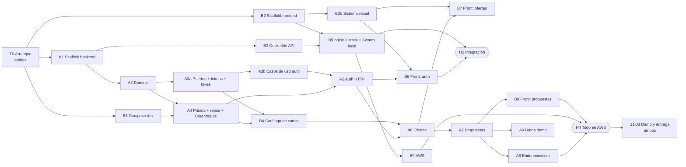

# FoilHub — Plan de implementación (2 personas)

## Supuestos

- Frontend en **React + Vite + TypeScript** (servido por nginx). Si eligen otro framework, solo cambian las tareas B2, B6, B7 y B8.
- Las duraciones están en **días de trabajo** (~4–5 h efectivas por persona). Total: ~19 días. Si la fecha de entrega es antes, recorten primero lo marcado como *opcional*.
- Ambas personas usan Fedora con Docker Engine, Node 24 y Claude Code.

## Roles

| | Persona A — Backend y dominio | Persona B — Plataforma y frontend |
|---|---|---|
| Se encarga de | Dominio, casos de uso, Prisma, auth, ofertas, propuestas, tests | Docker, nginx, Swarm, AWS, catálogo de cartas, frontend |
| Debe poder explicar en la defensa | Clean Architecture, reglas de negocio, transacciones | Orquestación, secrets, healthchecks, rolling updates, red |

Las dos personas deben entender todo el sistema. Por eso:
- Cada PR lo revisa **la otra persona**.
- B hace una parte del backend (catálogo de cartas, B4) y A revisa toda la infraestructura.
- En los hitos H2 y H4 se hace integración **juntos** (pair programming).

---

## Cómo trabajar con Claude Code

### Flujo de cada tarea

```bash
git checkout main && git pull
git checkout -b feat/A3b-auth-use-cases       # <tipo>/<ID>-<descripcion-corta>
claude                                         # desde la raíz del repo
```

Prompt base (cambien el ID):

```
Lee CLAUDE.md, docs/ARCHITECTURE.md y la tarea A3b en docs/PLAN.md.
Primero muéstrame un plan con los archivos que vas a crear o modificar y espera mi OK.
Después implementa la tarea cumpliendo todos sus criterios de aceptación,
corre lint, build y tests, y termina con un resumen de lo que hiciste y lo que quedó pendiente.
```

Después:
1. Revisen el diff ustedes (`git diff main`). No hagan merge de código que no entienden: lo van a tener que defender.
2. Marquen el checkbox de la tarea en este archivo dentro del mismo PR.
3. `git push` y abran el PR. La otra persona lo revisa. También puede pedirle a su Claude Code: `Revisa la rama feat/A3b-... contra CLAUDE.md y los criterios de A3b en docs/PLAN.md. Lista problemas, no corrijas nada.`
4. Squash merge a `main`.

### Consejos

- Una tarea = una rama = una sesión. Usen `/clear` entre tareas para que el contexto no se mezcle.
- Si Claude Code intenta instalar Prisma 8 (`@prisma/orm-postgres`, `contract.prisma`) o quitar una regla del linter (oxlint) para que pase el lint, deténganlo y recuérdenle `CLAUDE.md`.
- Si una tarea necesita cambiar el contrato de la API, primero abran un PR pequeño que solo modifique `docs/ARCHITECTURE.md` §6, apruébenlo los dos y después sigan.
- Para tareas grandes (A4, A7, B5), pídanle que trabaje por partes y que corra los tests al final de cada parte.

### Git

- `main` protegida: solo se entra por PR con 1 aprobación.
- Conventional Commits en español: `feat(offers): …`, `fix(nginx): …`, `test(domain): …`, `chore(docker): …`, `docs: …`.
- Las versiones se etiquetan en `main` (`v0.1.0`, `v0.2.0`, …) y las imágenes Docker usan ese tag.

### Dueños de archivos (para evitar conflictos)

| Ruta | Dueño | La otra persona |
|---|---|---|
| `backend/src/domain/**`, `backend/src/application/**` (excepto `use-cases/cards/`) | A | revisa |
| `backend/src/interface-adapters/di-tokens.ts` (todos los tokens, también los de cartas) | A | pide cambios en el PR |
| `backend/src/**/cards/**`, `cards.controller.ts`, `prisma-card.repository.ts`, `infrastructure/modules/cards.module.ts`, `infrastructure/external/**`, `infrastructure/cli/**` | B | revisa |
| `backend/prisma/schema.prisma` y migraciones | A | pide cambios en el PR |
| `backend/package.json`, `backend/package-lock.json` | A | B no ejecuta `npm install <pkg>` en `backend/`: lo pide en un PR de A |
| `backend/.oxlintrc.json`, `backend/tsconfig*.json`, `backend/nest-cli.json`, `backend/.env.example` | A | revisa |
| `backend/test/fakes/**` | A, **excepto** `in-memory-card.repository.ts` (lo crea A en A3a y después es de B) | revisa |
| `backend/test/e2e/` (configuración y helpers: levantar la app, limpiar `foilhub_test`) | A (lo crea en A4) | revisa |
| `backend/test/e2e/cards*.e2e-spec.ts` | B | revisa |
| `backend/src/infrastructure/modules/app.module.ts` | compartido | cada uno solo agrega la importación de su módulo |
| `backend/Dockerfile`, `backend/docker/`, `nginx/`, `docker-compose.yml`, `docker-stack.yml`, `scripts/`, `.github/` | B | revisa |
| `frontend/**` | B | revisa |
| `README.md` | B hasta J2; en J2 lo cierran los dos | no lo toca antes de J2 |
| `docs/ARCHITECTURE.md` (contrato) | ambos | cambios con aprobación de los dos |
| `docs/PLAN.md` | ambos | cada PR solo marca el checkbox de su tarea |

### Ramas y conflictos

- **Ramas cortas:** una tarea por rama, de preferencia ≤ 2 días. Cada mañana y antes de abrir el PR: `git fetch && git rebase origin/main`.
- **Orden de merge que desbloquea al otro** (A prioriza estos PRs y B los revisa el mismo día):
  1. A1 (fin del día 2) → desbloquea B3.
  2. A3a (puertos + tokens + fakes) y A4 (Prisma + `CoreModule` + harness e2e) → desbloquean B4.
  3. A5 → desbloquea B6.
  4. A6 / A7 → B7 / B8 cambian los fixtures por la API real.
- **Conflicto en `package-lock.json`:** quedarse con la versión de `main` (`git checkout origin/main -- backend/package-lock.json`), correr `npm install` en `backend/` y hacer commit del lockfile regenerado. Nunca editarlo a mano.
- **Conflicto en `app.module.ts`:** conservar las dos líneas de import.
- **Checkboxes de este archivo:** cada PR marca solo el suyo; están en líneas distintas y no chocan.
- **Si necesitas cambiar un archivo de la otra persona:** no lo cambies en tu rama. Coméntalo en la reunión diaria o abre un issue, y el dueño lo hace en un PR pequeño.

---

## Cronograma



| Días | Persona A | Persona B | Hito |
|---|---|---|---|
| 1 | T0 (juntos) | T0 (juntos) | Contrato de la API congelado |
| 2–4 | A1, A2 | B1, B2, B3 | **H1:** tests de dominio en verde, Postgres local, imagen de la API construye |
| 5–9 | A3a (primero, ~½ día), A4, A3b, A5 | B2b, B5, B4 (cuando estén A3a y A4), B6 (cuando esté A5) | **H2:** login funcionando a través de nginx en Swarm local, con el sistema visual aplicado |
| 10–14 | A6, A7 | B7, B8 (empiezan con fixtures), empieza B9 | **H3:** flujo completo (oferta → propuesta → aceptar) en Swarm local |
| 15–17 | A8, A9 | B9, B10 (opcional) | **H4:** todo desplegado en AWS |
| 18–19 | J1–J3 (juntos) | J1–J3 (juntos) | Entrega |

Reunión diaria de 15 minutos: qué terminé, qué sigue, qué me bloquea. Los hitos se verifican juntos.

---

## Fase 0 — Arranque (día 1, juntos)

### T0 · Preparar repo y entorno — *Ambos*
- [ ] T0 completada

- Copiar `CLAUDE.md`, `docs/`, `README.md` y `.gitignore` a la raíz del repo y hacer el primer commit en `main`.
- En GitHub: proteger `main` (Settings → Branches → requerir PR y 1 aprobación). Agregar a la segunda persona como colaboradora.
- Crear una cuenta (u organización) en Docker Hub con los repositorios públicos `foilhub-api` y `foilhub-nginx`.
- Cada persona en Fedora: Docker Engine, `docker swarm init` de prueba, Node 24 (`node -v` ≥ 22.22.3), `npm i -g @nestjs/cli`, Claude Code.
- Leer juntos `docs/ARCHITECTURE.md`. Si quieren cambiar algo del contrato de la API o de las reglas de negocio, este es el momento.
- Decidir quién es A y quién es B.

**Criterios de aceptación**
- Las dos personas ejecutan `docker run hello-world` y `docker info | grep Swarm` sin `sudo`.
- `main` está protegida y contiene estos documentos.
- Contrato de la API aceptado por los dos (commit `docs: congelar contrato v1`).

---

## Fase 1 — Cimientos (días 2–4)

### A1 · Scaffold del backend — *A* · depende de T0
- [x] A1 completada

- `nest new backend` (npm, ESM; si el scaffold en ESM da problemas con Prisma, usen CommonJS y actualicen la línea "Módulos" de `CLAUDE.md`).
- Crear la estructura de carpetas por capa de `CLAUDE.md` (con `.gitkeep` donde estén vacías). Mover `main.ts` y el módulo raíz a `src/infrastructure/`.
- Instalar Prisma **7** fijado: `npm i -D prisma@7` + `npm i @prisma/client@7 @prisma/adapter-pg@7 pg`. Crear `prisma.config.ts` y `prisma/schema.prisma` con solo `generator` y `datasource` (los modelos van en A4). Salida del cliente en `src/generated/prisma`.
  - `prisma` también debe quedar disponible en la imagen de producción para `migrate deploy` (B3 lo necesita).
- Linter con `no-restricted-imports` por capa (ver abajo). *Nota de implementación: Nest 12 genera **oxlint** en vez de ESLint; la misma regla vive en `backend/.oxlintrc.json` (overrides por carpeta, `regex` para rutas relativas).*
- `main.ts`: prefijo global `api`, `ValidationPipe` (`whitelist`, `forbidNonWhitelisted`, `transform`), `app.enableShutdownHooks()`, puerto desde `PORT` (por defecto 3000).
- `domain/errors/domain-error.ts` (clase base con `code`) y `interface-adapters/http/filters/domain-exception.filter.ts` que aplica la tabla de §3 y el formato de error de §6 (registrado global).
- `infrastructure/config/`: función `readSecret(name)` que devuelve el contenido de `process.env[name + '_FILE']` si existe, o `process.env[name]`; error claro si no hay ninguno.
- `GET /api/health` y `GET /api/health/live` con `@nestjs/terminus` en `infrastructure/health/` (por ahora ninguno consulta la BD; A4 agrega el chequeo solo a `/api/health`).
- Scripts en `package.json`: `start:dev`, `start:prod`, `build`, `lint`, `test`, `test:e2e`. Declarar también **desde ya** los de tareas futuras, aunque apunten a archivos que todavía no existen, para que nadie más tenga que tocar `package.json`: `cards:import` / `cards:import:prod` (→ `src/infrastructure/cli/import-cards.ts`, B4) y `seed:demo` / `seed:demo:prod` (A9).
- `backend/.env.example` con `PORT`, `DATABASE_URL`, `JWT_SECRET`, `JWT_EXPIRES_IN`, `CARD_CATALOG_SOURCE`.

Configuración de ESLint (flat config) a adaptar:

```js
const forbiddenLibs = ['@nestjs/*', '@prisma/*', '**/generated/**', 'class-validator', 'class-transformer', 'bcryptjs', 'jsonwebtoken', 'pg'];
export default [
  // ...config base generada por Nest
  { files: ['src/domain/**/*.ts'], rules: { 'no-restricted-imports': ['error', { patterns: [
    { group: forbiddenLibs, message: 'domain/ es TypeScript puro.' },
    { group: ['**/application/**', '**/interface-adapters/**', '**/infrastructure/**'], message: 'domain/ no depende de capas externas.' },
  ] }] } },
  { files: ['src/application/**/*.ts'], rules: { 'no-restricted-imports': ['error', { patterns: [
    { group: forbiddenLibs, message: 'application/ es TypeScript puro.' },
    { group: ['**/interface-adapters/**', '**/infrastructure/**'], message: 'application/ solo depende de domain/.' },
  ] }] } },
  { files: ['src/interface-adapters/**/*.ts'], rules: { 'no-restricted-imports': ['error', { patterns: [
    { group: ['**/infrastructure/**'], message: 'interface-adapters/ no depende de infrastructure/.' },
  ] }] } },
];
```

Si los patrones `**/x/**` no detectan rutas relativas como `../../infrastructure/foo.js`, usen la opción `regex` de los patrones de ESLint.

**Criterios de aceptación**
- `npm run lint`, `npm run build` y `npm test` pasan.
- `curl localhost:3000/api/health` → `200`.
- Prueba manual de la regla: un archivo temporal en `src/domain/` que importa `@nestjs/common` y otro en `src/application/` que importa `../infrastructure/...` hacen fallar `npm run lint`. Se borran después y se deja constancia en el PR.
- `npm ls prisma @prisma/client` muestra versiones 7.x.

### A2 · Capa de dominio — *A* · depende de A1
- [x] A2 completada

- Value objects: `Username`, `CardCode`, `Quantity`, `PlainPassword` (§3).
- Entidades: `User`, `Card`, `TradeOffer`, `TradeProposal` con `create()`/`restore()` y sus métodos de transición.
- `TradeMatcher.isMatch(a, b)`.
- Todos los errores de dominio de la tabla de §3, con su `code`.
- Las entidades no generan IDs ni fechas: los reciben como parámetro (vienen de `IdGenerator` y `Clock`).

**Criterios de aceptación** (cada punto es al menos un test)
- VOs: valores válidos e inválidos, normalización de `Username` (minúsculas) y `CardCode` (mayúsculas, sin espacios), límites de `Quantity` (0, 1, 99, 100, decimales).
- `TradeOffer.create` falla con la misma carta en los dos lados.
- `cancel`: solo el dueño, solo si está `OPEN`; `complete`: solo si está `OPEN`; `closedAt` se asigna.
- `TradeProposal`: `accept`/`reject` solo por el dueño de la oferta y solo en `PENDING`; `cancel` solo por el proponente; `autoReject`.
- `TradeMatcher`: un caso que sí es match y un caso que no lo es por cada una de las 4 condiciones.
- Cobertura de `src/domain/` ≥ 90% de líneas.
- Ningún archivo de `domain/` importa algo de fuera de `domain/` (lint en verde).

### B1 · Docker Compose para desarrollo — *B* · depende de T0
- [x] B1 completada

- `docker-compose.yml` en la raíz: servicio `db` (`postgres:17-alpine`, puerto `5432:5432`, usuario/clave `foilhub`/`foilhub_dev`, volumen con nombre) con healthcheck `pg_isready`.
- Script de inicialización en `docker/postgres-init/01-create-test-db.sql` (montado en `/docker-entrypoint-initdb.d` con `:z`) que crea la base `foilhub_test`.
- Opcional: `adminer` en el puerto 8081.
- Documentar en el `README.md` cómo levantarlo.

**Criterios de aceptación**
- `docker compose up -d` y después `docker compose exec db psql -U foilhub -l` muestra `foilhub` y `foilhub_test`.
- Funciona en Fedora con SELinux activado (sin errores de permisos).

### B2 · Scaffold del frontend — *B* · depende de T0
- [x] B2 completada

- `npm create vite@latest frontend -- --template react-ts`, agregar `react-router`.
- Estructura de §8. Layout con navegación y páginas vacías de todas las pantallas.
- `src/api/types.ts`: los tipos del contrato (§6) copiados tal cual.
- `src/api/client.ts`: wrapper de `fetch` que agrega `Authorization` si hay token, parsea el formato de error del contrato y lanza un `ApiError { statusCode, error, message }`.
- `AuthContext` (token + usuario en `localStorage`), `ProtectedRoute` que redirige a `/login`.
- `vite.config.ts` con proxy de `/api` a `http://localhost:3000`.
- Formularios de Login y Registro (validación básica en cliente). Se conectan a la API real en B6.

**Criterios de aceptación**
- `npm run build` y `npm run lint` pasan.
- Se puede navegar entre todas las páginas; las rutas protegidas redirigen a `/login`.
- `types.ts` coincide con §6 (la persona A lo revisa en el PR).

### B2b · Sistema visual — *B* · depende de B2
- [x] B2b completada

Objetivo: que todas las pantallas se vean como una sola app y que Claude Code no improvise estilos en cada página.

- **Herramienta:** Tailwind CSS 4 con el plugin oficial de Vite (`npm i tailwindcss @tailwindcss/vite`). En v4 no hay `tailwind.config.js`: la configuración va en CSS con `@theme`.
- **Tokens** en un solo archivo, `frontend/src/styles/theme.css` (bloque `@theme`):
  - Tema oscuro con onda "foil": fondo casi negro azulado, superficies en 2–3 niveles, texto principal y secundario, bordes.
  - Acento holográfico: un degradado (cian → violeta → rosa → dorado) para el botón principal, el logo y los bordes de las cartas destacadas, con un brillo animado suave que se desactiva con `prefers-reduced-motion`.
  - Colores semánticos: éxito, aviso, error, info. Estados de oferta y propuesta: `OPEN`, `PENDING`, `COMPLETED`, `ACCEPTED`, `REJECTED`, `CANCELLED`.
  - Colores de las cartas de Digimon (rojo, azul, amarillo, verde, negro, morado, blanco) para los badges de color.
  - Tipografía: una fuente de títulos con estilo digital/tecnológico (por ejemplo Chakra Petch) y una de texto muy legible (por ejemplo Inter), incluidas con `@fontsource` (sin depender de Google Fonts). Escala de tamaños, radios, sombras y espaciado.
- **Componentes genéricos** en `frontend/src/components/ui/`: `Button` (primario foil, secundario, ghost, peligro; tamaños; estado `loading`), `TextField` (label, ayuda, error), `Select`, `QuantityStepper` (1–99), `Combobox` (base para el buscador de cartas de B7), `Badge`, `Modal`, `Tabs`, `Pagination`, `Spinner`, `Skeleton`, `EmptyState`, `ErrorState` y `Toast` (proveedor + hook `useToast()`).
- **Componentes de la app** en `frontend/src/components/trading/`:
  - `CardTile`: imagen de la carta con proporción 63:88 (`loading="lazy"`, placeholder si `imageUrl` es `null`), código, nombre, `RarityBadge` y `ColorBadge`; variante compacta para listas.
  - `OfferCard`: "Doy" (carta + cantidad) → "Quiero" (carta + cantidad), dueño, `StatusBadge` y una zona de acciones. En el celular se apila en vertical (doy ↓ quiero).
  - `StatusBadge`, `RarityBadge`, `ColorBadge`.
- **Layout responsive** (mobile first): barra de navegación con menú hamburguesa en el celular, contenedor centrado, grilla de cartas de 2 columnas en el celular y 4–5 en escritorio.
- **Página de catálogo de componentes** `/_ui`, visible solo en desarrollo (`import.meta.env.DEV`), que muestra cada componente con todas sus variantes y estados. Sirve para revisar el diseño y como referencia para Claude Code.
- Script `npm run check:styles` que falla si encuentra colores sueltos (`#abc`, `#aabbcc`, `rgb(`, `hsl(`) en `src/pages`, `src/features` o `src/components` fuera de `styles/`.
- Rehacer el layout y los formularios de Login/Registro de B2 con estos componentes.

**Criterios de aceptación**
- `npm run build`, `npm run lint` y `npm run check:styles` pasan.
- `/_ui` muestra todos los componentes listados con sus variantes (incluye `CardTile` y `OfferCard` con datos de ejemplo de los tipos del contrato).
- Probado a 360 px y a 1280 px de ancho: sin scroll horizontal y con todo usable.
- Se puede usar todo con teclado, el foco es visible y el texto cumple contraste AA sobre el fondo oscuro.
- Con `prefers-reduced-motion` activado no hay animación de brillo.
- La persona A revisa `/_ui` en el PR y aprueba el look antes de que empiece B7.

### B3 · Imagen Docker de la API — *B* · depende de A1
- [x] B3 completada

- `backend/Dockerfile` multi-stage con `node:24-alpine`:
  1. `deps`: `npm ci`.
  2. `build`: `npx prisma generate` y `npm run build`.
  3. `runtime`: `apk add --no-cache openssl`, solo dependencias de producción (con el CLI de `prisma` disponible), `package.json` (los scripts `*:prod` se ejecutan con `npm run` dentro del contenedor), `dist/`, `prisma/`, `prisma.config.ts`, `docker/entrypoint.sh`; usuario `node`; `EXPOSE 3000`; `ENTRYPOINT ["/app/docker/entrypoint.sh"]`.
- `backend/docker/entrypoint.sh` como en `docs/ARCHITECTURE.md` §9 (ajustar la ruta de `dist/main.js` a la salida real del build).
- `backend/.dockerignore` (`node_modules`, `dist`, `.env`, `src/generated`, `coverage`).

**Criterios de aceptación**
- `docker build -t foilhub-api:dev backend` funciona sin errores.
- Con el Postgres de B1 en marcha: `docker run --rm --network host -e DB_HOST=localhost -e DB_PORT=5432 -e DB_NAME=foilhub -e DB_USER=foilhub -e DB_PASSWORD=foilhub_dev -e JWT_SECRET=dev -e RUN_MIGRATIONS=true foilhub-api:dev` arranca y `curl localhost:3000/api/health` → `200`.
- El contenedor corre como usuario `node` (`docker exec <id> whoami`).
- La imagen pesa menos de ~350 MB (`docker images`).

---

## Fase 2 — Auth, catálogo y Swarm local (días 5–9)

### A3 · Puertos y casos de uso de auth — *A* · depende de A2

Se entrega en **dos PRs** para que B4 no espere a los casos de uso de auth.

#### A3a · Puertos, tokens y fakes (PR pequeño, ~½ día; es lo primero que hace A en la fase 2)
- [x] A3a completada

- **Todos** los puertos de `docs/ARCHITECTURE.md` §4 en `application/ports/` (también los de cartas), con el tipo `Page<T>`.
- `interface-adapters/di-tokens.ts` con **todos** los tokens: repositorios (incluido `CARD_REPOSITORY`), `UNIT_OF_WORK`, `PASSWORD_HASHER`, `TOKEN_SERVICE`, `CARD_CATALOG_PROVIDER`, `ID_GENERATOR`, `CLOCK`. B no edita este archivo.
- Fakes en `backend/test/fakes/`: `InMemoryUserRepository`, `InMemoryCardRepository`, `InMemoryTradeOfferRepository`, `InMemoryTradeProposalRepository`, `InMemoryUnitOfWork`, `FakePasswordHasher`, `FakeTokenService`, `SequentialIdGenerator`, `FixedClock`. Después del merge, `in-memory-card.repository.ts` pasa a ser de B.

**Criterios de aceptación**
- `npm run lint`, `npm run build` y `npm test` pasan.
- Los puertos no importan nada fuera de `domain/` y `application/`.

#### A3b · Casos de uso de auth — depende de A3a
- [x] A3b completada

- `RegisterUserUseCase`, `LoginUserUseCase`, `GetCurrentUserUseCase`.

**Criterios de aceptación**
- Tests de los tres casos de uso: registro correcto, username repetido (sin distinguir mayúsculas), contraseña débil, login correcto, usuario inexistente y clave incorrecta devuelven el **mismo** error.
- Los casos de uso no importan nada fuera de `domain/` y `application/`.

### A4 · Persistencia con Prisma — *A* · depende de A2, A3a, B1
- [x] A4 completada

- Modelos de `docs/ARCHITECTURE.md` §5 en `schema.prisma`; primera migración `init` + migración con el índice único parcial (SQL manual).
- `infrastructure/prisma/prisma.service.ts` (extiende el cliente generado, usa `@prisma/adapter-pg`, conecta en `onModuleInit`, desconecta al apagar).
- Mappers y repositorios Prisma de `User`, `TradeOffer`, `TradeProposal` (el de `Card` lo hace B en B4) y `PrismaUnitOfWork`.
- `TradeOfferRepository.save`: al cerrar una oferta usa `updateMany({ where: { id, status: 'OPEN' } })` y lanza `ConcurrencyConflictError` si afecta 0 filas.
- Agregar el chequeo de BD a `/api/health` (`PrismaHealthIndicator` de terminus o un `SELECT 1`). `/api/health/live` sigue sin consultar la BD.
- `infrastructure/modules/core.module.ts` (`@Global`): exporta `PrismaService`, `ID_GENERATOR` (`CryptoIdGenerator`), `CLOCK` (`SystemClock`), `UNIT_OF_WORK` y los repositorios de `User`, `TradeOffer` y `TradeProposal`. El de cartas **no** va aquí: lo provee y exporta `CardsModule` (B4). Con esto B4 puede cablear su módulo sin esperar a A5.
- Harness de e2e en `backend/test/e2e/`: configuración de `test:e2e`, helper que levanta la app Nest contra `foilhub_test` y limpia las tablas entre tests. B4 y A5 escriben sus specs encima, cada uno en su propio archivo.

**Criterios de aceptación**
- `npx prisma migrate dev` crea las tablas en una base vacía; `npx prisma migrate deploy` funciona en la base de test.
- Tests de integración de los repositorios contra `foilhub_test`: guardar y leer cada entidad, `listOpen` con filtros, `findMatchCandidates`, conflicto de concurrencia, rollback de `PrismaUnitOfWork` si el callback lanza error.
- Insertar a mano dos propuestas `PENDING` del mismo usuario sobre la misma oferta falla por el índice.
- Con Postgres detenido, `/api/health` devuelve `503` y `/api/health/live` sigue devolviendo `200`.
- Ningún tipo de `src/generated/prisma` aparece en `application/` ni en `domain/`.

### A5 · Auth por HTTP — *A* · depende de A3b, A4
- [x] A5 completada

- Capa 4: `BcryptPasswordHasher` (`bcryptjs`, costo 12), `JwtTokenService` (`@nestjs/jwt`, secreto con `readSecret('JWT_SECRET')`, expiración `JWT_EXPIRES_IN`) y `AuthModule` (usa el `CoreModule` de A4).
- Capa 3: `AuthController` (`register`, `login`, `me`), DTOs de request con `class-validator`, presenters, `JwtAuthGuard`, `OptionalJwtAuthGuard` (no falla sin token, para `GET /api/offers`), decorador `@CurrentUser()`.
- `@nestjs/throttler` solo en `/api/auth/*` (por ejemplo 10 peticiones/minuto).

**Criterios de aceptación**
- e2e: registro → login → `me` con el token; registro duplicado → `409 USERNAME_TAKEN`; login incorrecto → `401 INVALID_CREDENTIALS`; `me` sin token o con token vencido → `401`; body con campos extra → `400 VALIDATION_ERROR`.
- La contraseña no aparece en ninguna respuesta ni en los logs.
- Las respuestas siguen exactamente el contrato de §6.

### B4 · Catálogo de cartas — *B* · depende de A3a, A4
- [x] B4 completada

- Casos de uso: `SearchCardsUseCase`, `GetCardByCodeUseCase`, `ImportCardCatalogUseCase` (upsert por `code`; omite y cuenta las cartas con código inválido).
- Capa 3: `PrismaCardRepository` + mapper; `CardsController` (`GET /api/cards`, `GET /api/cards/:code`); presenter `CardDto`.
- Capa 4: `DigimonCardIoCatalogProvider` (con `fetch`), `JsonFileCatalogProvider` que lee `backend/prisma/seed/cards.sample.json`, elegido con `CARD_CATALOG_SOURCE=digimoncardio|file`; `CardsModule`, que provee **y exporta** `CARD_REPOSITORY` (A6 lo importa). Usa `PrismaService` e `ID_GENERATOR` del `CoreModule` de A4.
- CLI `infrastructure/cli/import-cards.ts` (contexto standalone de Nest). Los scripts `cards:import` y `cards:import:prod` ya los declaró A1: B4 **no** modifica `package.json` (y no necesita dependencias nuevas: usa `fetch` nativo).
- `cards.sample.json` con ~40 cartas reales de 2–3 sets (obtenidas una sola vez del API), para desarrollo, tests y por si el API externo falla en la demo.
- Documentación del API externo: https://documenter.getpostman.com/view/14059948/TzecB4fH . Tiene límite de peticiones: el catálogo se importa **una vez** a la BD; la API de FoilHub nunca llama a digimoncard.io en una petición de usuario.

**Criterios de aceptación**
- `CARD_CATALOG_SOURCE=file npm run cards:import` carga el JSON; correrlo dos veces no duplica cartas.
- `CARD_CATALOG_SOURCE=digimoncardio npm run cards:import` importa el catálogo real e imprime `{ imported, skipped }`.
- `GET /api/cards?search=agu` devuelve resultados paginados; `pageSize > 50` se limita a 50; código inexistente → `404 CARD_NOT_FOUND`.
- Tests de los casos de uso con fakes y un e2e de búsqueda.

### B5 · nginx, stack de Swarm y scripts — *B* · depende de B2, B3
- [x] B5 completada

- `nginx/Dockerfile` multi-stage (contexto = raíz del repo): etapa `node:24-alpine` que hace `npm ci && npm run build` en `frontend/`, etapa `nginx:stable-alpine` que copia `dist/` y `nginx/nginx.conf`.
- Build arg `APP_VERSION` (lo pasa `build-push.sh` con el tag) expuesto al frontend como `VITE_APP_VERSION` y mostrado en el footer. Así el rolling update de la demo se ve en el navegador.
- `nginx/nginx.conf` y `docker-stack.yml` según `docs/ARCHITECTURE.md` §9.
- Scripts en `scripts/` (bash con `set -euo pipefail`, mensaje de uso si faltan argumentos):
  - `create-secrets.sh`: crea `db_password` (`openssl rand -hex 24`) y `jwt_secret` (`openssl rand -hex 32`) si no existen.
  - `build-push.sh <tag>`: construye y sube `foilhub-api` y `foilhub-nginx` a `$REGISTRY`.
  - `deploy.sh <tag>`: `docker stack deploy --with-registry-auth` con `REGISTRY` y `TAG`.
  - `import-cards.sh`: busca un contenedor de `foilhub_api` en el nodo actual y ejecuta `npm run cards:import:prod`.
- Swarm local de un nodo: `docker node update --label-add db=true $(docker node ls -q)`.

**Criterios de aceptación**
- En Swarm local: `docker stack services foilhub` muestra todas las réplicas listas (`2/2`, `3/3`, `1/1`).
- `http://localhost/` sirve el frontend y `http://localhost/api/health` → `200` a través de nginx.
- `docker rm -f` de un contenedor de la API → Swarm crea otro y vuelve a `3/3`.
- `docker service inspect foilhub_api` y `foilhub_db` no muestran ninguna contraseña.
- nginx arranca bien aunque la API todavía no esté lista (gracias al `resolver`).

### B6 · Frontend: autenticación real — *B* · depende de A5, B2b
- [x] B6 completada

- Conectar Login y Registro a la API. Mostrar los errores del contrato en español. Cerrar sesión. Si una respuesta es `401`, borrar el token y redirigir a `/login`.

**Criterios de aceptación**
- Registro, login, recarga de página (la sesión se mantiene) y logout funcionan contra la API local y contra el Swarm local.

### 🔗 H2 · Integración (juntos, fin del día 9)
- [ ] H2 verificado

Juntos: `scripts/build-push.sh v0.1.0`, deploy en Swarm local, registrarse e iniciar sesión desde el navegador en `http://localhost`. Cada uno explica al otro lo que hizo en esta fase.

---

## Fase 3 — Ofertas y propuestas (días 10–14)

### A6 · Ofertas — *A* · depende de A5, B4
- [x] A6 completada

- Casos de uso de ofertas de `docs/ARCHITECTURE.md` §4: crear, listar abiertas, listar mías, detalle, cancelar (con auto-rechazo de propuestas en `UnitOfWork`), buscar matches.
- `OffersController` con los endpoints de §6; `OfferPresenter` (necesita cartas y dueño: cargarlos en lote, sin N+1).
- `OffersModule` importa `CardsModule` (de B4) para obtener `CARD_REPOSITORY`; no lo vuelve a declarar.
- `GET /api/offers` usa `OptionalJwtAuthGuard` para excluir las ofertas propias si hay sesión.

**Criterios de aceptación**
- Tests de casos de uso: crear con carta inexistente → `CARD_NOT_FOUND`; misma carta → `SAME_CARD_TRADE`; cancelar oferta ajena → `FORBIDDEN`; cancelar dos veces → `OFFER_NOT_OPEN`; al cancelar, las propuestas pendientes quedan `REJECTED`; `matches` solo devuelve ofertas que pasan `TradeMatcher`.
- e2e de cada endpoint de ofertas (caso feliz + un error).

### A7 · Propuestas — *A* · depende de A6
- [x] A7 completada

- Casos de uso de propuestas de §4. `AcceptProposalUseCase` hace todo dentro de **una** transacción de `UnitOfWork`.
- `ProposalsController` + `POST /api/offers/:id/proposals` (puede ir en `OffersController`); `ProposalPresenter` con `contacts` solo cuando corresponde.

**Criterios de aceptación**
- Tests: proponer sobre oferta propia → `SELF_TRADE`; propuesta duplicada → `DUPLICATE_PROPOSAL`; `counterOfferId` que no hace match → `COUNTER_OFFER_NOT_MATCHING`; aceptar completa oferta y contraoferta y rechaza las demás pendientes; aceptar/rechazar ajena → `FORBIDDEN`; cancelar solo el proponente.
- Test de concurrencia (e2e): dos `accept` simultáneos de propuestas distintas sobre la misma oferta → uno `200`, el otro `409`.
- `contacts` es `null` para propuestas no aceptadas y para usuarios que no son parte.

### B7 · Frontend: ofertas — *B* · depende de A6, B2b (puede empezar antes con datos simulados usando los tipos del contrato)
- [x] B7 completada

- Si A6 todavía no está en `main`: las llamadas viven en `src/api/offers.ts` y devuelven fixtures tipados con `types.ts`. Al mergear A6 solo cambia la implementación de esas funciones, no las pantallas.
- Buscador de cartas con autocompletado (`GET /api/cards?search=`), con imagen y código.
- Explorar ofertas (filtros por carta ofrecida/buscada, paginación), detalle de oferta, crear oferta, mis ofertas (filtro por estado, botón cancelar, sección "Matches").

**Criterios de aceptación**
- Un usuario puede crear una oferta eligiendo las dos cartas con el buscador, verla en "Mis ofertas", verla desde otra cuenta en "Explorar" y cancelarla.
- Estados de carga, vacío y error en cada pantalla.
- Las pantallas solo usan componentes de `components/ui/` y `components/trading/` y tokens del tema; `npm run check:styles` pasa. Se ven bien a 360 px.

### B8 · Frontend: propuestas — *B* · depende de A7 (puede empezar antes con fixtures en `src/api/proposals.ts`, igual que B7)
- [x] B8 completada

- En el detalle de una oferta ajena: "Proponer trade" con mensaje opcional y selector de "mi oferta que hace match" (de `GET /api/offers/:id/matches` sobre mis ofertas, o filtrando mis ofertas abiertas).
- Página de propuestas con pestañas Recibidas/Enviadas; aceptar, rechazar, cancelar; al aceptar, mostrar el contacto de la otra persona.

**Criterios de aceptación**
- Flujo completo con dos navegadores (o una ventana privada): A publica, B propone, A acepta, los dos ven el contacto y las ofertas quedan `COMPLETED`.
- Cada acción muestra un toast de éxito o error; `npm run check:styles` pasa; se ve bien a 360 px.

### 🔗 H3 · Flujo completo en Swarm local (fin del día 14)
- [ ] H3 verificado

`v0.2.0` desplegada en Swarm local y el flujo de B8 funcionando ahí.

---

## Fase 4 — AWS y endurecimiento (días 13–17)

### B9 · Despliegue en AWS — *B* (A acompaña al menos una sesión) · depende de B5
- [ ] B9 completada

- Seguir `docs/DEPLOY-AWS.md` completo: Security Group, 3 EC2, Elastic IP, Docker, Swarm, etiqueta `db=true`, secrets, deploy, importación del catálogo.
- Se puede empezar en la Fase 3 con `v0.1.0` y luego actualizar.

**Criterios de aceptación**
- `docker node ls` en el manager muestra 3 nodos `Ready`.
- `http://<elastic-ip>/` funciona desde cualquier red.
- Las réplicas de `api` están repartidas en más de un nodo (`docker service ps foilhub_api`).
- Se ensayaron todos los pasos del guion de demo de `docs/DEPLOY-AWS.md`.

### A8 · Endurecimiento del backend — *A* · depende de A7
- [ ] A8 completada

- Swagger en `/api/docs` con `@nestjs/swagger` (decoradores solo en controllers y DTOs de la capa 3).
- Logs: el `Logger` de Nest registra método, ruta, status y duración de cada petición (un interceptor), y el `hostname` del contenedor, para mostrar en la demo qué réplica atendió.
- Verificar el apagado ordenado: durante `docker service update` con tráfico constante (un bucle de `curl`) no hay errores 5xx.
- e2e del flujo completo (2 usuarios, ofertas inversas, matches, propuesta con contraoferta, aceptar, verificar estados y contactos).

**Criterios de aceptación**
- `/api/docs` lista todos los endpoints de §6.
- `docker service logs foilhub_api` muestra las peticiones con el hostname de cada réplica.
- e2e del flujo completo en verde.

### A9 · Datos de demo — *A* · depende de A7
- [ ] A9 completada

- Script `seed:demo` (y `seed:demo:prod`) que crea 3 usuarios (`ana`, `beto`, `carla`, con contraseña conocida para la demo) y ofertas, de las cuales al menos 2 pares hacen match. Es idempotente.

**Criterios de aceptación**
- Después del seed, al entrar como `ana` hay matches visibles en "Mis ofertas".

### B10 · CI con GitHub Actions — *B* · *opcional* · depende de B5
- [ ] B10 completada

- En cada PR: lint, build y tests del backend (con un servicio Postgres en el job) y build del frontend.
- Al crear un tag `v*`: construir y subir las dos imágenes a Docker Hub (usuario y token como secrets de GitHub).

### 🔗 H4 · Todo en AWS (fin del día 17)
- [ ] H4 verificado

Versión `v1.0.0` desplegada en AWS con datos de demo y catálogo importado.

---

## Fase 5 — Demo y entrega (días 18–19, juntos)

### J1 · Ensayo de la demo
- [ ] J1 completada

Ensayar dos veces el guion de `docs/DEPLOY-AWS.md` (§ Guion de demo), cronometrado. Cada persona presenta la parte de la otra al menos una vez.

### J2 · Documentación y evidencias
- [ ] J2 completada

- `README.md` final: qué es, arquitectura (enlace a `docs/ARCHITECTURE.md`), cómo correrlo en local, cómo desplegar.
- Capturas en `docs/evidence/`: `docker node ls`, `docker stack services`, `docker service ps`, visualizer, rolling update, la app funcionando, tests en verde.

### J3 · Preguntas de la defensa
- [ ] J3 completada

Preparar respuestas cortas para:
- ¿Dónde está la regla de dependencia y cómo la hacen cumplir? (oxlint `no-restricted-imports` + estructura + `useFactory`)
- ¿Qué pasa si se cae un nodo worker? ¿Y el manager? (1 manager = sin alta disponibilidad del plano de control; con 3 managers se tolera la caída de 1)
- ¿Por qué la base de datos tiene una sola réplica y está fijada a un nodo?
- ¿Cómo llegan los secretos a los contenedores y por qué no son variables de entorno?
- ¿Cómo evitan que dos personas acepten la misma oferta a la vez?
- ¿Qué cambiarían para producción real? (HTTPS, varios managers, Postgres administrado como RDS, backups, monitoreo)
